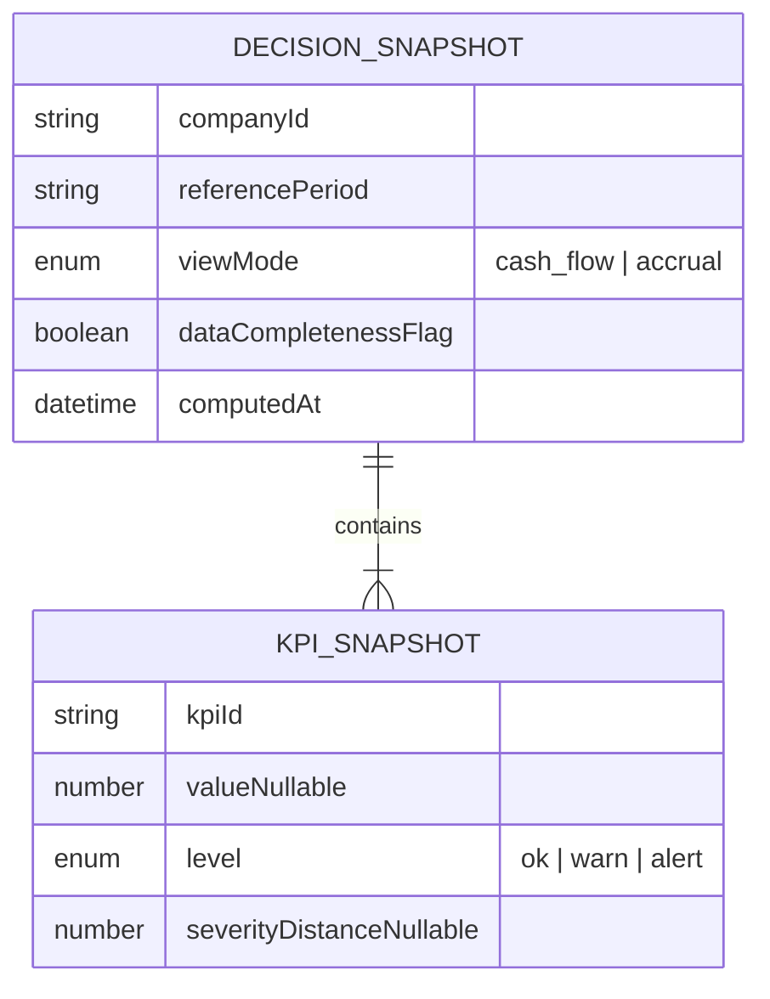

# Data model — Decision Engine

## 1. Persistence (v1)

**No Mongo collection required** for the engine in v1. The decision is **derived** from an in-memory snapshot.

Optional future:

| Entity | Purpose |
| --- | --- |
| `DecisionAuditLog` | Store `inputHash`, `output`, `ruleEngineVersion`, `companyId`, `createdAt` for support/LGPD |

## 2. Logical model (snapshot)

- **`severityDistance`:** distance to the zone border (for FR-2); optional in the input — if absent, resolver can derive from `value` + fixed bands **only if** bands are duplicated in the backend in v1; **recommendation:** composer sends` severityDistance `already calculated by the same module that calculates levels, for single source of truth.

## 3. Completeness of data (FR-0) — minimum criteria v1

**Definition:** full snapshot * * when all of the conditions below are true.

| # | Rule | If it fails |
| --- | --- | --- |
| C1 | `referencePeriod` present (ISO `YYYY-MM`) | Incomplete |
| C2 | `viewMode` present | Incomplete |
| C3 | `netIncomeMonth` reported and **> 0** (net income for the period — basis for % and savings) | Incomplete |
| C4 | Mandatory KPI `monthly_cash_flow`: valid numeric `value` **and** `level` set | Incomplete |
| C5 | Mandatory KPI `savings_rate`: `level` set (value can be omitted only if upstream policy marks invalid → incomplete) | Incomplete |
| C6 | Mandatory KPI `income_committed_pct`: `level` set | Incomplete |
| C7 | Required KPI `credit_utilization_index`: `level` set **and** if `level` ≠ `ok`, requires numeric `value` (% usage) to parameterize impact | Incomplete **only if** `value` missing when ≠ ok |
| C8 | Required KPI `surplus_capacity`: `level` set | Incomplete |
| C9 | Mandatory KPI `fixed_vs_variable_split`: `level` set (interpret as “high fixed share” when alert) | Incomplete |

** Optional KPIs (absence ≠ incomplete):**

| KPI | Behavior |
| --- | --- |
| `checking_runway_days` | If absent, liquidity step 1 considers **only** `monthly_cash_flow`. |
| `debt_service_to_income` | If absent, skip step 2 (`debt_pressure`). |

**Reason in FR-0:** populate `reason` with `["data_quality"]` or the list of `kpiId` values that failed completeness.

## 4. Action × context matrix (v1 seed)

Parameterization: placeholders` {amount} `,` {pct} `,` {days} `replaced when number available; otherwise qualitative text allowed by spec.

### `data_incomplete`

| # | title | description | impact | reason |
| --- | --- | --- | --- | --- |
| 1 | Complete your financial data | Register net income for the month, card limits and transactions to generate safe recommendations. | Complete the fields in red in the monthly view to see impact in $ R. | Dynamic: KPIs/`data_quality` as per §3 (field `ordering_rationale` + `actions[].reason`) |

### `healthy`

| # | title | description | impact | reason |
| --- | --- | --- | --- | --- |
| 1 | Automate your leftover | Set up a fixed transfer for booking the day after payment. | Even **$50/month** already consolidate habits without tightening the budget. | `["savings_rate"]` |

### `liquidity_risk`

| # | title | description | impact | reason |
| --- | --- | --- | --- | --- |
| 1 | Pause non-essential spending for 30 days | Freeze discretionary purchases until the flow is back to blue. | Reduces overdraft risk up to **{amount}/month** if you cut the average variable plan. | `monthly_cash_flow`, `checking_runway_days` |
| 2 | Redraw due dates | Align vouchers and card for after income entries. | Liquidity gain equivalent to **{days} days** of cash slack. | `monthly_cash_flow` |
| 3 | Use only debit or PIX until normalized | Avoid new purchases on credit while the cashier is negative. | Prevents **{pct}%** increase in threshold usage. | `credit_utilization_index`, `monthly_cash_flow` |

### `debt_pressure`

| # | title | description | impact | reason |
| --- | --- | --- | --- | --- |
| 1 | Negotiate or refinance the lowest high-interest balance | Prioritize card/revolving before cheap borrowing. | Typical savings **{amount}/month** in interest if rate drops **{pct} p.p.** | `debt_service_to_income` |
| 2 | Freeze new installments | Do not add installments until debt service falls below 25% of income. | Releases up to **{pct}%** of income to cash. | `debt_service_to_income`, `income_committed_pct` |

### `credit_overuse`

| # | title | description | impact | reason |
| --- | --- | --- | --- | --- |
| 1 | Pay above the minimum on the main card | Allocate weekly lump sum until usage drops below 40%. | Reduces usage from **{pct}%** to target **40%** in ~2–3 cycles. | `credit_utilization_index` |
| 2 | Stop purchases on credit until normalized | Use debit until `credit_utilization_index` goes off alert. | High cash impact | `credit_utilization_index` |

### `high_commitment`

| # | title | description | impact | reason |
| --- | --- | --- | --- | --- |
| 1 | Cut 2 subscriptions or fixed services | List Netflix, duplicate gym, apps — trade or cancel. | Releases up to **{amount}/month**. | `income_committed_pct` |
| 2 | Review housing and insurance | Renegotiate rent/condominium or exchange auto/home insurance. | Goal: reduce commitment by **{pct} p.p.** | `income_committed_pct` |

### `low_surplus`

| # | title | description | impact | reason |
| --- | --- | --- | --- | --- |
| 1 | Reduce discretionary variable by 10% | Restaurant/ delivery adjustment until baseline returns to the median of 3 months. | Recover up to **{amount}/month** to spare. | `surplus_capacity` |
| 2 | Rebook large purchase | Postpone over **{amount}** until next month with positive surplus. | Prevents one-off negative flow. | `surplus_capacity`, `monthly_cash_flow` |

### `low_savings`

| # | title | description | impact | reason |
| --- | --- | --- | --- | --- |
| 1 | Auto-save goal | Transfer **{pct}%** of income on checkout day. | Raises savings rate by **{pct} p.p.** immediately. | `savings_rate` |
| 2 | Break an expensive weekly habit | Replace 2 external meals with homemade ones. | Typical savings **{amount}/month**. | `savings_rate` |

### `high_fixed_cost`

| # | title | description | impact | reason |
| --- | --- | --- | --- | --- |
| 1 | Gain slack in what you can still do | Home or car financing, rent and school are often long-term contracts — prioritize variable, avoid new fixes, and review short-cycle plans before targeting large renegotiation. | Direction: improve the balance between fixed and the rest of the month by about **{pct} p.p.** | `fixed_vs_variable_split` |

**Selection:** by `primary_issue`, choose up to **3** lines from top to bottom; remove lines whose `reason` does not intersect KPIs in `warn`/`alert` **except** first anchor line of the theme when applicable.

## 5. Versioning

- Matrix or C1–C9 changes require `RULE_ENGINE_VERSION` bump and internal changelog input.