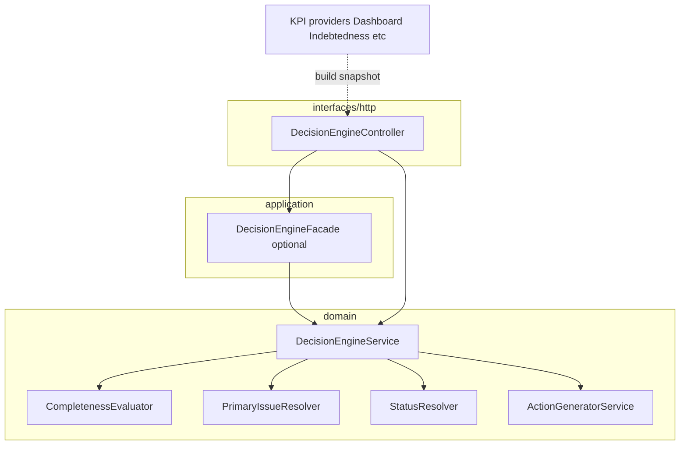

# Technical plan — Decision Engine (NestJS)

**Feature:** `001-financial-decision-engine`  
**Spec:** `spec.md` v0.2  
**Target codebase:** `back-end-financeiro-nestjs` (implementation); this directory holds the SDD artifacts.

## 1. Goals

- **Deterministic**, **non-AI** service that turns a **snapshot of KPIs + levels + completeness** into `status`, `primary_issue`, and `actions[]` per contract.
- **FR-0** (`data_incomplete`) is evaluated **before** any ladder logic.
- **Testable** layers with injectable dependencies; **thin controller** (HTTP + DTO validation only).

## 2. Architecture overview

### 2.1 Layering (NestJS module `decision-engine`)

```
src/decision-engine/
├── decision-engine.module.ts
├── interfaces/http/
│   └── decision-engine.controller.ts      # routing + DTO + calls application only
├── application/
│   └── decision-engine.facade.ts          # optional single domain call (skip if service is already thin)
├── domain/
│   ├── decision-engine.service.ts         # main orchestrator (domain entry)
│   ├── completeness.evaluator.ts        # FR-0 — data complete?
│   ├── primary-issue.resolver.ts        # FR-1 + FR-2 — ladder + tie-break
│   ├── status.resolver.ts               # FR-13 / FR-0 override
│   ├── action-generator.service.ts      # FR-8/9/11 — catalog + parameterization
│   ├── constants.ts                     # RULE_ENGINE_VERSION, KPI_ORDER (lex tie-break), FR-5/6 weights
│   └── catalog/
│       └── action-catalog.ts            # primary_issue × action templates matrix (PT-BR copy)
├── dto/
│   ├── decision-engine-request.dto.ts
│   └── decision-engine-response.dto.ts
└── *.spec.ts (next to the units under test)
```

**Note:** If `decision-engine.facade.ts` is redundant with `DecisionEngineService`, keep **one** public entrypoint (`DecisionEngineService`) registered on the module and omit the facade — this plan accepts either design as long as the controller contains **no** business rules.

### 2.2 Responsibilities

| Component | Responsibility |
| --- | --- |
| **CompletenessEvaluator** | Evaluates `DecisionEngineInput.dataCompleteness` + hard rules (§7); returns `true/false` and `missingKpis` / `invalidKpis` lists. |
| **DecisionEngineService** | If incomplete → build FR-0 response; else → resolve `primary_issue` → `status` → `actions`. |
| **PrimaryIssueResolver** | Applies FR-1 ladder on **levels** (`ok` \| `warn` \| `alert`); skips rungs without KPI; FR-2 tie-break. |
| **StatusResolver** | `critical` / `attention` / `healthy` per FR-13; **FR-0** forces `attention`. |
| **ActionGeneratorService** | Looks up catalog by `primary_issue` + triggering levels; parameterizes `impact` with numeric input; max 3; ensures minimum 1 for `healthy` and `data_incomplete`. |

### 2.3 KPI input boundary

- **Do not** recalculate KPIs in this module in v1: the **HTTP client** (another Nest service or the same aggregating controller) builds `DecisionEngineInput` from existing services (`Dashboard`, `Indebtedness`, etc.) **or** exposes an endpoint that delegates to a future **DecisionEngineComposerService** in the “financial health” bounded context.
- The engine **only** consumes the contract in `contracts/decision-engine.types.ts`.

### 2.4 Diagram (container)



## 3. `primary_issue` catalog (v1)

Align **spec FR-1** with product-requested slugs. The ladder requires themes for **committed income** and **surplus**; they were missing from the short list of 7 items — **required** for spec fidelity:

| FR-1 order | `primary_issue` slug | Main KPI(s) |
| --- | --- | --- |
| FR-0 | `data_incomplete` | (completeness policy) |
| 1 | `liquidity_risk` | `checking_runway_days`, `monthly_cash_flow` |
| 2 | `debt_pressure` | `debt_service_to_income` |
| 3 | `credit_overuse` | `credit_utilization_index` |
| 4 | **`high_commitment`** | `income_committed_pct` |
| 5 | **`low_surplus`** | `surplus_capacity` |
| 6 | `low_savings` | `savings_rate` |
| 7 | `high_fixed_cost` | `fixed_vs_variable_split` (excess fixed share) |
| — | `healthy` | all ok + complete data |

**Legacy aliases (avoid):** spec mentions names like `liquidity_crisis`; **do not use** on the API — only slugs in this table.

## 4. Prioritization and determinism

1. **CompletenessEvaluator** runs first → if incomplete, fixed return (`primary_issue=data_incomplete`, `status=attention`, FR-0 catalog actions).
2. If complete: **PrimaryIssueResolver** walks order 1→7; first rung with any KPI in **`warn` or `alert`** sets the theme **only if** that rung is “active” (see §7: optional KPI absent = rung skipped, not incomplete).
3. **FR-2 tie-break:** within the same rung, highest numeric “severity” (distance to zone boundary); tie → lexicographic order in `constants.ts` (`KPI_LEX_ORDER`).
4. **No** `Math.random`, current time, or I/O on the hot path.
5. **`RULE_ENGINE_VERSION`:** string constant (`"1.0.0"`) exported; included in logs and optionally HTTP header `X-Decision-Engine-Version`.

## 5. Status (`FR-13`)

| Condition | `status` |
| --- | --- |
| FR-0 triggered | `attention` |
| Alert on ladder levels 1–3 **or** `monthly_cash_flow` = `alert` | `critical` |
| Otherwise: `warn` or `alert` on levels 4–7 | `attention` |
| All `ok` | `healthy` |

## 6. HTTP integration

- **Suggested route:** `POST /companies/:companyId/decision-engine/evaluate`
- **Guards:** `JwtAuthGuard`, `CompanyGuard`, financial read permission (reuse `indebtedness` / `dashboard` pattern).
- **Body:** `DecisionEngineRequestDto` — mirrors `DecisionEngineInput` (see contracts).
- **Response:** `DecisionEngineResponseDto` — mirrors spec JSON output.
- **Controller:** validates DTO, calls `DecisionEngineService.evaluate(input)`, returns DTO; **zero** business branching.

### Composer (outside the engine)

A separate service (e.g. `DecisionEngineComposerService` in `dashboard` or a new aggregator) can:

1. Collect period data (`referenceMonth`, `cashFlowView`).
2. Calculate or fetch existing KPIs.
3. Fill `dataCompleteness` and `kpiSnapshots`.
4. Call `DecisionEngineService.evaluate`.

This keeps the engine **pure** and simplifies unit tests with fixtures.

## 7. Observability

- **Structured log (Pino):** `info` per successful request with fields:
  - `ruleEngineVersion`
  - `companyId` (id only)
  - `primary_issue`, `status`
  - list of `{ kpiId, level }` received
  - `data_complete: boolean`
  - optional hash/checksum of normalized payload (no PII)
- **Do not** log long transaction descriptions.
- **Debug:** `debug` with decision tree (which rung won) only in dev or via flag.

## 8. Testing strategy (backend SDD)

- **Unit:** `CompletenessEvaluator`, `PrimaryIssueResolver`, `StatusResolver`, `ActionGeneratorService`, `DecisionEngineService` with expected input/output fixtures.
- **Required cases:** FR-0 wins; healthy → exactly 1 action; critical when level 3 alert; lex tie-break; optional KPI absent vs incomplete.
- **Controller spec:** DTO validation + mocked service.

## 9. Module registration

- `DecisionEngineModule`: `providers` exporting `DecisionEngineService` if other modules need it; `controllers` with `DecisionEngineController`.
- Import in `AppModule`.
- **No** circular dependency: engine does not import `DashboardModule` directly; whoever composes input imports both.

## 10. Trade-offs

| Decision | Pros | Cons |
| --- | --- | --- |
| Catalog in TypeScript (v1) | Deterministic, typed, easy PR diff | Copy changes require deploy |
| Numeric KPI in input | UI can show parameterized “impact” | Composer must send reliable numbers |
| No external DSL | No parser/risk | Less flexible for non-devs |

## 11. Files to add (implementation checklist)

- [ ] `src/decision-engine/**/*.ts` per §2.1 tree  
- [ ] `decision-engine.module.ts` + `app.module.ts` import  
- [ ] `*.spec.ts` tests  
- [ ] Swagger decorators on controller + DTOs (`@ApiProperty`)  
- [ ] Export of shared types (optional): duplicate interfaces on the front via manual copy or future shared package — **out of scope for this plan**

---

## Document history

| Version | Date | Notes |
| --- | --- | --- |
| 0.1 | 2026-05-04 | Initial plan from spec v0.2 |
