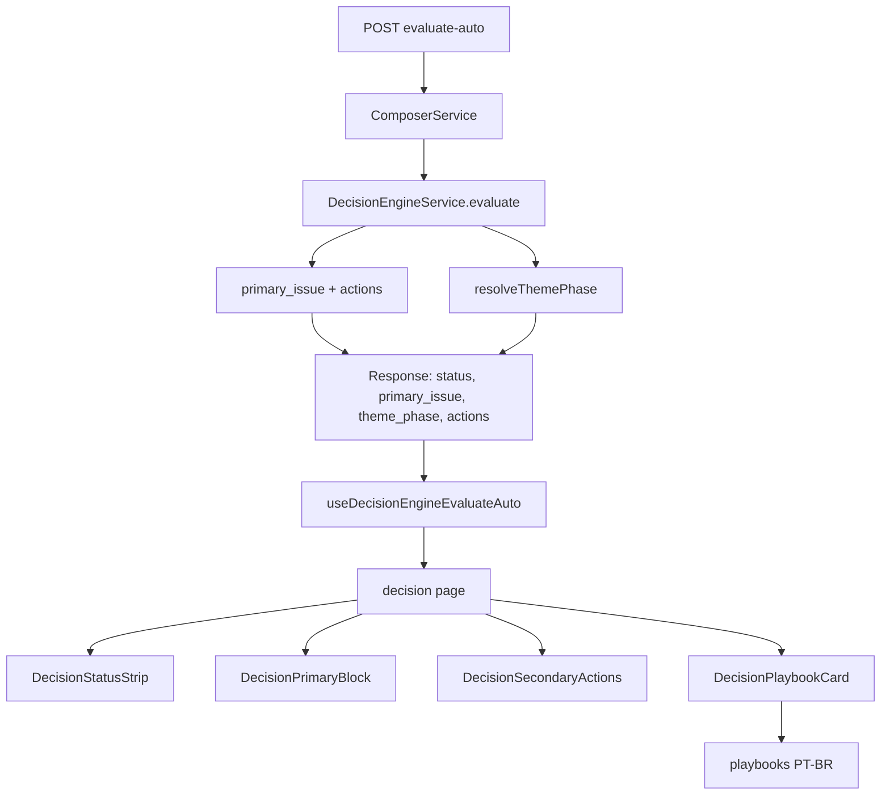

# Plan — Decision playbook 3 phases

> HOW for `spec.md`. Hybrid architecture: backend only resolves the active phase per theme; all PT-BR content lives on the frontend. Nothing in the existing contract breaks — `theme_phase` is an optional/nullable field.

---

## 1. Approach summary

- **Backend** gains only an optional field `theme_phase: 'red' | 'yellow' | 'green' | null`. Pure numeric logic: theme phase derives from the primary KPI level of `primary_issue` (`alert→red`, `warn→yellow`, `ok→green`; `data_incomplete→null`; `healthy→green`).
- **Frontend** gains a PT-BR playbook catalog (9 entries) and a new component that renders the active-phase playbook below the current "Next step" + "Other steps".
- The "Next step" with calculated R$ / % **stays untouched** — it is the hook that gets the user to act today. The playbook teaches the full path.

---

## 2. Phase map by theme

| Theme (slug) | Primary KPI used for phase |
| --- | --- |
| `liquidity_risk` | `monthly_cash_flow` (fallback `checking_runway_days`) |
| `debt_pressure` | `debt_service_to_income` |
| `credit_overuse` | `credit_utilization_index` |
| `high_commitment` | `income_committed_pct` |
| `low_surplus` | `surplus_capacity` |
| `low_savings` | `savings_rate` |
| `high_fixed_cost` | `fixed_vs_variable_split` |
| `healthy` | always `green` |
| `data_incomplete` | `null` (shows placeholder) |

---

## 3. Backend — minimal changes

### 3.1. Phase resolver

**New file**: `back-end-financeiro-nestjs/src/decision-engine/domain/theme-phase.resolver.ts`.

```ts
export type ThemePhase = 'red' | 'yellow' | 'green';

const THEME_DRIVER_KPI: Record<PrimaryIssueSlug, KnownKpiId | null> = {
  liquidity_risk: 'monthly_cash_flow',
  debt_pressure: 'debt_service_to_income',
  credit_overuse: 'credit_utilization_index',
  high_commitment: 'income_committed_pct',
  low_surplus: 'surplus_capacity',
  low_savings: 'savings_rate',
  high_fixed_cost: 'fixed_vs_variable_split',
  healthy: null,
  data_incomplete: null,
};

export function resolveThemePhase(primary, kpis): ThemePhase | null { ... }
```

Mapping: `alert → red`, `warn → yellow`, `ok|undefined → green`. `healthy → green`. `data_incomplete → null`. Fallback when driver KPI is missing: worst level among KPIs in the matching step in `DECISION_LADDER` (`decision-engine.constants.ts`).

**Spec co-located**: `theme-phase.resolver.spec.ts` covering each slug in `ok`/`warn`/`alert` + `healthy` + `data_incomplete` + missing KPI.

### 3.2. Output and DTO

`src/decision-engine/domain/decision-engine.types.ts`:

```ts
export type ThemePhase = 'red' | 'yellow' | 'green';

export interface DecisionEngineOutput {
  status: DecisionStatus;
  primary_issue: PrimaryIssueSlug;
  theme_phase: ThemePhase | null;
  ordering_rationale: string;
  actions: readonly DecisionAction[];
  ruleEngineVersion?: string;
}
```

`src/decision-engine/dto/decision-engine-response.dto.ts` — add:

```ts
@ApiProperty({
  enum: ['red', 'yellow', 'green'],
  nullable: true,
  description: 'PT-BR: primary theme phase (red / yellow / green). null when primary_issue=data_incomplete.',
})
readonly theme_phase!: ThemePhase | null;
```

### 3.3. Service and controller

`src/decision-engine/domain/decision-engine.service.ts`: in final composition (`data_incomplete` and normal branches), call `resolveThemePhase(primaryIssue, input.kpis)` and include in output.

`src/decision-engine/interfaces/http/decision-engine.controller.ts`: `toResponseDto` propagates `theme_phase` from output.

### 3.4. Tests to extend

- `decision-engine.service.spec.ts`: assert `theme_phase` in `healthy` / `data_incomplete` / each slug with `alert+warn+ok` scenarios.
- `decision-engine.controller.spec.ts`: ensure `theme_phase` serialization.
- `test/decision-engine-evaluate-auto.e2e-spec.ts`: snapshot includes `theme_phase ∈ {red, yellow, green, null}`.

---

## 4. Frontend — catalog + UI

### 4.1. Service schema

`apps/web/src/services/decisionEngineService.ts` — extend Zod:

```ts
const ThemePhaseSchema = z.enum(['red', 'yellow', 'green']);

const DecisionEngineEvaluateResponseSchema = z.object({
  ...,
  theme_phase: ThemePhaseSchema.nullable().optional(),
  ...,
});
```

Backward compatible: payloads without `theme_phase` parse normally (field `undefined`).

### 4.2. Playbook catalog

New folder: `apps/web/src/pages/decision/playbooks/`.

```
playbooks/
  types.ts                    # Playbook, PhaseContent, ThemePhase, PlaybookSlug
  index.ts                    # getPlaybook(slug), ALL_PLAYBOOKS
  liquidityRisk.ts
  debtPressure.ts
  creditOveruse.ts
  highCommitment.ts
  lowSurplus.ts
  lowSavings.ts
  highFixedCost.ts
  healthy.ts
  dataIncomplete.ts
  playbooks.test.ts           # validates shape for all slugs
```

Shape: see `data-model.md` and `contracts/decision-engine.types.ts`.

`playbooks.test.ts`:
- For each slug, `actions.length` between 3 and 5 in all 3 phases.
- `rule` and `expectedImpact` non-empty.
- Forbidden terms list: see `playbooks.test.ts` (PT-BR jargon + technical tokens).
- Unknown slug falls back to `healthy`.

### 4.3. `DecisionPlaybookCard` component

`apps/web/src/pages/decision/components/DecisionPlaybookCard.tsx`. Receives `playbook: Playbook` and `phase: ThemePhase | null | undefined`. Renders with DS primitives (`Card`, `CardHeader`, `CardContent`, `Badge`):

- Header: theme title + active phase Badge (`destructive`, custom amber, `success`).
- "What is happening" block: `explanation`.
- "Your step-by-step plan" block — 3 sub-sections (red, yellow, green) in an **accessible accordion** (`<button aria-expanded aria-controls>` + `role="region"`), with the active phase **expanded by default**.
- "Simple rule" block: light visual emphasis (`border-l-4 border-l-primary-500`) with `Lightbulb` icon.
- "Expected outcome" block: single sentence, `Sparkles` icon, positive tone.
- `phase === null | undefined`: card shows only explanation + message "Complete your data…" — no accordion.

Mobile-first (`px-4 sm:px-6`, `space-y-4`), dark mode via DS tokens, no hardcoded colors outside semantic tokens.

### 4.4. Page integration

`apps/web/src/pages/decision/index.tsx`: after `DecisionSecondaryActions`, render:

```tsx
<DecisionPlaybookCard
  playbook={getPlaybook(query.data.primary_issue)}
  phase={query.data.theme_phase ?? null}
/>
```

Nothing else changes on the page (`DecisionStatusStrip`, `DecisionPrimaryBlock`, `DecisionSecondaryActions` stay intact).

### 4.5. UI tests

- `DecisionPlaybookCard.test.tsx`:
  - renders correct phase expanded (`aria-expanded='true'`);
  - toggles accordion when clicking another phase;
  - shows placeholder for `data_incomplete` (phase null);
  - renders "Simple rule" and "Expected outcome" blocks.
- `playbooks.test.ts`: valid shape for all 9 slugs.

---

## 5. Final flow diagram



---

## 6. Quality gates

- Backend: `yarn lint` + `yarn jest <theme-phase|service|controller>` (with `--runInBand` because of global `MongoMemoryServer` in `src/test/setup.ts`).
- Frontend: `yarn typecheck` + `yarn lint` in monorepo; green suites in `pages/decision/`, `services/decisionEngineService`, `hooks/useDecisionEngineEvaluateAuto`.
- No new dependencies.
- No changes to `.env`.

---

## 7. Risk / mitigation

| Risk | Mitigation |
| --- | --- |
| Legacy client receives `theme_phase` and breaks | Field is optional/nullable; frontend Zod handles `undefined` and `null`. |
| Catalog outdated for a new slug | `getPlaybook` falls back to `healthy` (safe fallback); `'falls back to healthy'` test covers. |
| Technical text leaking to users | Forbidden terms list validated in `playbooks.test.ts`. |
| Inaccessible accordion | `aria-expanded` + `aria-controls` + visible focus; test covers interaction via `role="button"` / `role="region"`. |
